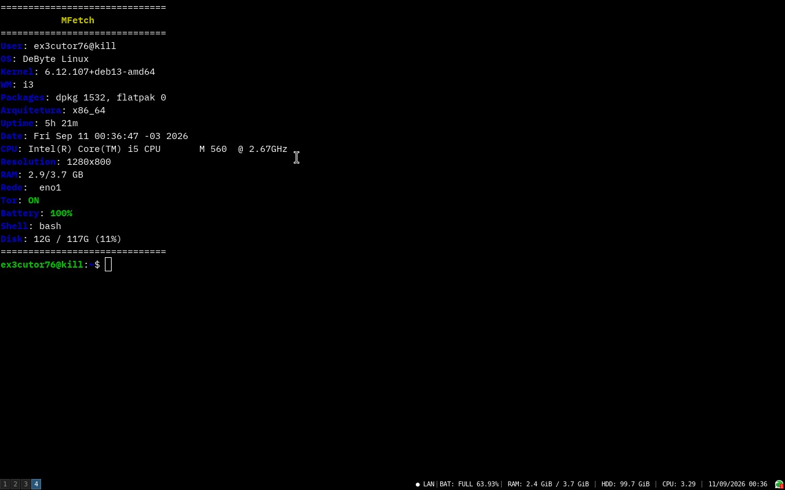
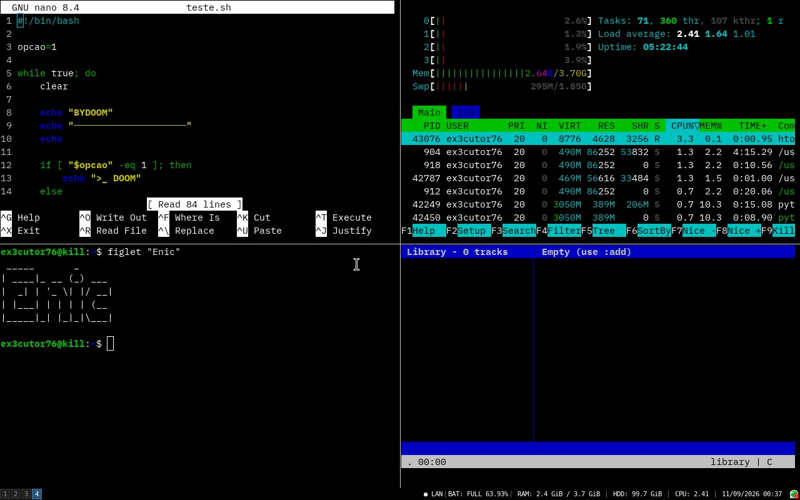

# O que é o ENIC?

ENIC é um emulador de terminal feito em perl, com objetivo de ser um emulador de terminal leve e com poucas dependências, utilizando o VTE/GTK3 para fornecer ao emulador a interface gráfica, enquanto seu shell tradicional é o bash.

## Por que o nome Enic?

O nome "Enic" é em homenagem ao Eniac, um dos primeiros computadores eletrônicos digitais de propósito geral da história da computação, com a imaginação de uma pergunta de "Como seria um terminal do Eniac se ele tivesse uma tela? E tivesse evoluído com o tempo?".

## Filosofia

Ser o mais leve possível e fácil de utilizar, mantendo apenas recursos necessários para uma experiência confortável de terminal.

## Recursos

- Emulação de terminal através de VTE 2.91;
- Interface GTK3;
- Shell configurável (caminho absoluto);
- Scrollback configurável;
- Cursor configurável;
- Fonte configurável;
- Cor de fundo configurável;
- Copiar e colar;
- Menu de contexto;
- Selecionar tudo;
- Limpeza de terminal;
- Split vertical;
- Split horizontal;
- Integração com i3 e rofi;
- Arquivo .desktop;
- Instalação global através de `/usr/local/bin`;

## Requisitos

* Perl;
* GTK3;
* VTE 2.91;
* Pango;
* Bash;

**Aviso importante**: As dependências podem variar dependendo da distro Linux.

## Instalação

```bash
git clone https://github.com/Ex3cutor76-V1/Enic.git
cd Enic/
sudo ./install.sh
```

**Aviso importante**: O arquivo `install.sh` não compila e muito menos modifica o sistema de forma invasiva. Ele apenas organiza os arquivos do Enic nos diretórios apropriados e cria os atalhos necessários para facilitar seu acesso e integração no sistema.

## Configuração

As configurações ficam em `~/.config/enic/enic.conf` (ou `$XDG_CONFIG_HOME/enic/enic.conf`). O arquivo é criado automaticamente na primeira execução. Edite com qualquer editor de texto, por exemplo:

```bash
nano ~/.config/enic/enic.conf
```

Quatro opções estão disponíveis:

```ini
font=IBM Plex Mono 11
shell=/bin/bash
scrollback=2500
background=#000000
```

- `font`: descrição de fonte aceita pelo Pango; a família precisa existir no sistema;
- `shell`: caminho absoluto para um executável, por exemplo `/bin/bash` ou `/usr/bin/zsh`;
- `scrollback`: número de linhas, de 0 a 9000;
- `background`: cor em hexadecimal `#RRGGBB`.

Valores inválidos geram um aviso e são substituídos pelos padrões. Chaves desconhecidas também geram aviso e são ignoradas. As mudanças passam a valer na próxima execução do Enic.

## Split


